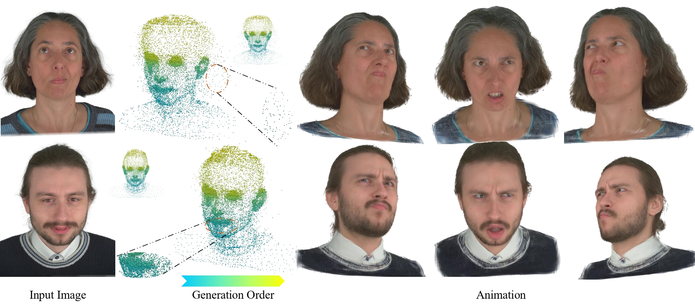
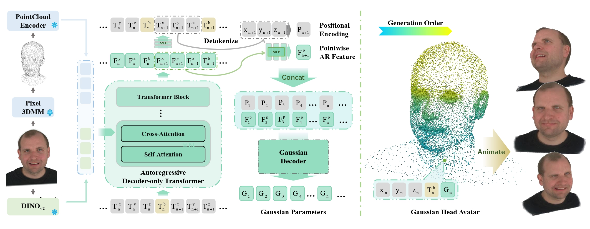

# AvatarPointillist: AutoRegressive 4D Gaussian Avatarization

[](https://kumapowerliu.github.io/AvatarPointillist/)
[](#citation)
[](#citation)
[](#release-status)

<p align="center">
  
</p>

> **AvatarPointillist** is an autoregressive framework for generating dynamic 4D Gaussian avatars from a single portrait image.

## More Research

<details open>
<summary><strong>💡 We also have other avatar projects that may interest you.</strong></summary>

<br>

> #### [HeadArtist: Text-conditioned 3D Head Generation with Self Score Distillation, SIGGRAPH 2024](https://kumapowerliu.github.io/HeadArtist/)
> [](https://github.com/ant-research/HeadArtist)
> [](https://kumapowerliu.github.io/HeadArtist/)
> [](https://arxiv.org/abs/2312.07539)

> #### [Follow-Your-Emoji: Fine-Controllable and Expressive Freestyle Portrait Animation, SIGGRAPH Asia 2024](https://follow-your-emoji.github.io/)
> [](https://github.com/mayuelala/FollowYourEmoji)
> [](https://follow-your-emoji.github.io/)
> [](https://arxiv.org/abs/2406.01900)

> #### [AvatarArtist: Open-Domain 4D Avatarization, CVPR 2025](https://kumapowerliu.github.io/AvatarArtist/)
> [](https://github.com/ant-research/AvatarArtist)
> [](https://kumapowerliu.github.io/AvatarArtist/)
> [](https://arxiv.org/abs/2503.19906)

</details>

## Overview

AvatarPointillist formulates avatar generation as a sequential prediction problem. Starting from a single portrait image, the method:

- autoregressively generates Gaussian point clouds with a decoder-only Transformer
- jointly predicts per-point binding for animation
- decodes full renderable Gaussian attributes with a dedicated Gaussian decoder
- produces photorealistic and controllable 4D avatars

This branch contains the supplied research implementation with fixes from a static code review. Training and inference were not run during review. See [setup and usage](docs/SETUP.md), [the Chinese review report](docs/STATIC_REVIEW_zh.md), and [third-party notices](THIRD_PARTY.md).

## Release Status

This is a **static-review release candidate** on `codex/static-review-release`.

- AR geometry training and inference, Gaussian decoder code, portable example configurations, and setup instructions are included.
- Checkpoints and original model assets are archived under [KumaPower/AvatarPointillist](https://huggingface.co/KumaPower/AvatarPointillist), initially **private**. See [model upload status](MODEL_UPLOAD_STATUS.json) and [SHA-256 inventory](models_manifest.json).
- Models were not executed and the environment is not runtime-validated. Numerical quality, paper metrics, and CUDA/multi-GPU compatibility remain to be checked.
- Third-party model permissions and a project-wide license have not been unified. Original notices are preserved.

Start with [SETUP.md](docs/SETUP.md). From the repository root, after installing dependencies and obtaining model access:

```bash
python scripts/download_models.py
python test_ar.py --config_dir configs/ar_inference.yaml
bash avatarpointillist/scripts_gstrans/inference.sh
```

Inputs require a portrait and tracked FLAME shape parameters; this package does not include an automatic portrait-to-FLAME tracker.

## Method at a Glance

<p align="center">
  
</p>

AvatarPointillist contains two tightly coupled stages:

1. An autoregressive generator predicts Gaussian geometry tokens together with binding information.
2. A Gaussian decoder converts the generated representation into complete renderable Gaussian attributes for animation and rendering.

Conditioning the decoder on latent features from the autoregressive generator substantially improves the final avatar fidelity.

## Authors

[Hongyu Liu](https://kumapowerliu.github.io/)<sup>1,2</sup>, [Xuan Wang](https://xuanwangvc.github.io/)<sup>2</sup>, [Zijian Wu](https://zijian-wu.github.io/)<sup>2</sup>, [Yating Wang](https://scholar.google.com/citations?user=w1tn5rUAAAAJ&hl=zh-CN)<sup>2</sup>,  [Ziyu Wan](http://raywzy.com/)<sup>3</sup>, [Yue Ma](https://mayuelala.github.io/)<sup>1</sup>, [Runtao Liu](https://liuruntao.github.io/)<sup>1</sup>, [Boyao Zhou](https://yaourtb.github.io/)<sup>2</sup>, [Yujun Shen](https://shenyujun.github.io/)<sup>2</sup>, [Qifeng Chen](https://cqf.io/)<sup>1</sup>

<sup>1</sup> HKUST, <sup>2</sup> Ant Group, <sup>3</sup> City University of Hong Kong

## Included in This Branch

The source branch includes:

- candidate environment setup (not runtime-tested)
- checkpoint download instructions and a private owner model archive
- demo and inference scripts
- training pipeline
- data preparation instructions

## Citation

If you find this project useful, please cite:

```bibtex
@inproceedings{liu2026avatarpointillist,
  title     = {AvatarPointillist: AutoRegressive 4D Gaussian Avatarization},
  author    = {Hongyu Liu and Xuan Wang and Zijian Wu and Yating Wang and Ziyu Wan and Yue Ma and Runtao Liu and Boyao Zhou and Yujun Shen and Qifeng Chen},
  booktitle = {Proceedings of the IEEE/CVF Conference on Computer Vision and Pattern Recognition},
  year      = {2026}
}
```

## Contact

For project-related questions, please use the author homepages above or refer to the project page:

[https://kumapowerliu.github.io/AvatarPointillist/](https://kumapowerliu.github.io/AvatarPointillist/)
